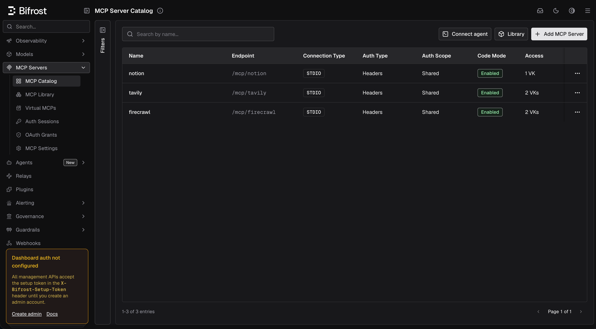
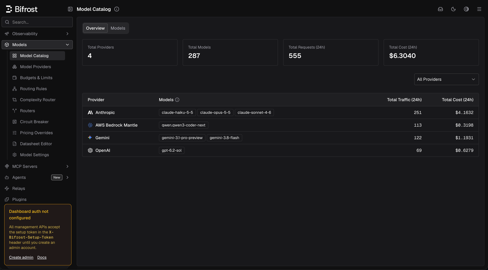

# Code Mode Discovery Benchmark

Does a model, asked to use an MCP server by name, work out that the server is reachable only through code mode, and use it there without being told how?

This is the problem users hit with [code mode](https://docs.getbifrost.ai/mcp/code-mode): a model did not find a tool it had not used before until the user said "it's in code mode, look there". Bifrost now tells the model which code mode servers it can reach ([maximhq/bifrost#10228](https://github.com/maximhq/bifrost/pull/10228)). This benchmark measures whether that works, on 3 MCP servers and 7 models.

It is separate from the token and latency rounds in the [code mode benchmark](../README.md), and uses the same runner, `benchmark.py`.

## Results

7 models, 3 MCP servers, 8 queries, at `medium` reasoning effort, November 2026. "Discovered" is out of 8 queries; Turns is the average number of model calls per query.

| Model | Discovered | Avg turns | Errors |
|-------|------------|-----------|--------|
| `anthropic/claude-opus-5-5` | 8/8 | 3.9 | 0 |
| `openai/gpt-6.2-sol` | 8/8 | 5.5 | 0 |
| `anthropic/claude-haiku-5-5` | 8/8 | 4.2 | 0 |
| `gemini/gemini-3.8-flash` | 8/8 | 5.9 | 1 |
| `bedrock_mantle/qwen.qwen3-coder-next` | 8/8 | 5.8 | 1 |
| `anthropic/claude-sonnet-4-6` | 8/8 | 4.2 | 0 |
| `gemini/gemini-3.1-pro-preview` | 8/8 | 4.1 | 0 |

Every request completed, and every model reached the server each query named through code mode, without being told the server was in code mode or how to use it. Under the key without Notion (DS8), every model said Notion was not available to it and did not try to use it.

Qwen3 Coder Next called a server's name as if it were a tool in four queries (DS1, DS4, DS6, DS7). Bifrost answered each such call with how to reach that server through code mode, and Qwen then used it through `executeToolCode`. The Errors column counts calls that failed as unavailable and were then corrected in the same query.

The three MCP servers as connected in Bifrost for this run, each with Code Mode enabled (Notion on one virtual key; Tavily and Firecrawl on both, including the key without Notion used by DS8):



The seven models and their four providers in the same Bifrost, with the traffic from the runs:



## What is tested

**MCP servers.** Notion, Tavily and Firecrawl, connected only in code mode. None of their tools is in the model's tool list, so the only way in is `listToolFiles` → `readToolFile` → `executeToolCode`. All three need a key, so a model cannot get the answer some other way.

| Client | Server | Key | Description in Bifrost |
|--------|--------|-----|------------------------|
| `notion` | `@notionhq/notion-mcp-server@2.6.1` (stdio) | `NOTION_TOKEN` | Team workspace docs: wiki pages, notes and databases |
| `tavily` | `tavily-mcp@0.2.22` (stdio) | `TAVILY_API_KEY` | Web search for current news and answers |
| `firecrawl` | `firecrawl-mcp@3.41.0` (stdio) | `FIRECRAWL_API_KEY` | none: only its tool names describe it |

**Models**, each at `medium` reasoning effort:

```
anthropic/claude-opus-5-5
openai/gpt-6.2-sol
anthropic/claude-haiku-5-5
gemini/gemini-3.8-flash
bedrock_mantle/qwen.qwen3-coder-next
anthropic/claude-sonnet-4-6
gemini/gemini-3.1-pro-preview
```

**Queries** (`eval_tasks.json`). Every query names the server it needs, as a user would ("Use Tavily to…", "our Notion workspace"), and none says that the server is in code mode or how to reach it: finding that out is what is measured. The run uses the neutral system message, which names no server, so what the model knows about the servers comes from Bifrost: the code mode catalogue in the `listToolFiles` description and the pointer line in the system message.

| Queries | What it checks |
|---------|----------------|
| DS1, DS6 | Tavily searches |
| DS2, DS4 | Notion workspace pages and search |
| DS3, DS5 | Firecrawl scrape and site map |
| DS7 | Tavily and Notion in one request |
| DS8 | A Notion question under a key without Notion; the model must not try to use Notion |

## How a query is scored

A request returning HTTP 200 ("OK") only means it went through. `summary` reads the agent loop from the Bifrost logs that `run` fetches and adds the **Discovered** column:

- **Passes** when the model reached the named server through code mode: it read the server's file with `readToolFile` / `getToolDocs`, or called it from `executeToolCode`. If a tool then fails on a bad key, an auth error or a provider error, the query still passes: the model found the server, which is what is measured.
- **Fails** when the model never gets there: it answers without the server, says it is not available, or calls the server's name as if it were a tool and does not recover.
- **DS8 passes** when the model never tries to use Notion (no call, module or file named after it) and answers.
- **Left out** when the request failed before the model did anything (an upstream timeout): there is nothing to judge.

The columns `summary` prints for each query:

| Column | Meaning |
|--------|---------|
| Found | Every `expected_servers` entry was found through code mode: its file was read with `readToolFile` / `getToolDocs`, or `executeToolCode` called it. A query run under a key that cannot reach a server (`unavailable_server`) passes when the model never tries to use that server and answers; using the servers the key does reach is fine. |
| Turns | Model calls in the agent loop. The intended code mode flow (`listToolFiles`, `readToolFile`, `executeToolCode`, answer) takes 3-4. |
| Discovery | `listToolFiles` / `readToolFile` / `getToolDocs` calls before the first `executeToolCode`. |
| Tool calls | All tool calls in the agent loop; 0 means the model never used a tool. |
| Errors | Calls that failed as unavailable, for diagnosis: a tool name Bifrost does not serve, such as `ListToolFiles` for `listToolFiles` or the server's name called as if it were a tool, a call answered "not permitted", or code naming a server the sandbox does not bind (`undefined: Notion` when the client is `notion`). |

A server counts as called when `executeToolCode` code calls one of its tools (`notion.search(...)`: code mode binds each server as a module named after the Bifrost client). Names are compared case-insensitively, so the Bifrost client names must match `expected_servers`. A query with no matched log is listed as unscored, never as found.

## Setup

The benchmark never reads or stores keys; Bifrost holds them. It needs a provider key for each of the seven models:

| Models | Provider key in Bifrost |
|--------|-------------------------|
| `anthropic/*` | `ANTHROPIC_API_KEY` |
| `openai/*` | `OPENAI_API_KEY` |
| `gemini/*` | `GEMINI_API_KEY` |
| `bedrock_mantle/*` | AWS access key, secret key and region (`bedrock_mantle_key_config`) |

and the three MCP servers in code mode:

```json
"mcp": {
  "client_configs": [
    {"name": "notion", "description": "Team workspace docs: wiki pages, notes and databases",
     "connection_type": "stdio", "stdio_config": {"command": "npx", "args": ["-y", "@notionhq/notion-mcp-server@2.6.1"], "envs": ["NOTION_TOKEN"]},
     "is_code_mode_client": true, "tools_to_execute": ["*"], "tools_to_auto_execute": ["*"]},
    {"name": "tavily", "description": "Web search for current news and answers",
     "connection_type": "stdio", "stdio_config": {"command": "npx", "args": ["-y", "tavily-mcp@0.2.22"], "envs": ["TAVILY_API_KEY"]},
     "is_code_mode_client": true, "tools_to_execute": ["*"], "tools_to_auto_execute": ["*"]},
    {"name": "firecrawl",
     "connection_type": "stdio", "stdio_config": {"command": "npx", "args": ["-y", "firecrawl-mcp@3.41.0"], "envs": ["FIRECRAWL_API_KEY"]},
     "is_code_mode_client": true, "tools_to_execute": ["*"], "tools_to_auto_execute": ["*"]}
  ]
}
```

`envs` names the variables Bifrost passes from its own environment, so start Bifrost with `NOTION_TOKEN`, `TAVILY_API_KEY` and `FIRECRAWL_API_KEY` set. Share a few Notion pages with the Notion integration. Create two virtual keys: one that reaches all three servers, and one that reaches Tavily and Firecrawl only.

## Running

From `mcp-code-mode-benchmark/`:

```bash
export BIFROST_BASE_URL=http://localhost:8080/openai
export BIFROST_API_KEY=<key with all three servers>
export BENCH_VK_WITHOUT_NOTION=<key without notion>
export BIFROST_SETUP_TOKEN=<setup token>   # or BIFROST_ADMIN_USER / BIFROST_ADMIN_PASSWORD, for fetch-logs

python benchmark.py run --name discovery --eval-file discovery-benchmark/eval_tasks.json --system-message neutral --parallel \
  --model anthropic/claude-opus-5-5 openai/gpt-6.2-sol anthropic/claude-haiku-5-5 gemini/gemini-3.8-flash \
          bedrock_mantle/qwen.qwen3-coder-next anthropic/claude-sonnet-4-6 gemini/gemini-3.1-pro-preview
python benchmark.py summary --name discovery                    # one row per model
python benchmark.py summary --name discovery/claude-haiku-5-5   # one model, query by query
```

That is 7 runs of 8 queries, one process per model at the same time, about 5 minutes. `BENCH_VK_WITHOUT_NOTION` is only used by DS8; that query fails if it is unset. To measure a Bifrost change, run the same command against the gateway before and after it and compare the two `summary` tables: Discovered, Avg turns and Errors.
